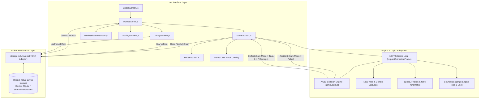

# Turbo Rush: Highway Speed Demon
## Complete Project Technical & Architecture Documentation
*Version 1.0.0 — React Native Bare CLI (Android & iOS)*

---

## 1. Executive Summary & Game Concept

**Turbo Rush: Highway Speed Demon** is a fast-paced, arcade-style mobile highway racing game built entirely from scratch with **React Native (Bare CLI 0.88.1)**. 

The player maneuvers high-performance supercars through dense multi-lane highway traffic, executing close-call near-miss overtakes, gathering coins, triggering nitro dash boosts, dodging crashes, and collecting tactical powerups (Safe Mode Shields, Coin Magnets, Health Repair Packs, and Nitro Refills).

### Core Pillars
* **100% Offline & Zero Backend**: No cloud servers, backend APIs, or user registrations are required. All career progression—including total coins accumulated, highest scores, longest distances traveled, vehicle purchases, and active garage selections—persists locally on the device using a fail-safe SQLite/Key-Value storage engine.
* **Pure React Native 60 FPS Engine**: Smooth, uninhibited frame rate managed via `requestAnimationFrame`, math-driven Axis-Aligned Bounding Box (AABB) collision geometry, procedural highway strip scrolling, and native-driver hardware-accelerated animations.
* **Tactile Dark-Neon Cyberpunk UI/UX**: Dynamic theme system adapting to the selected vehicle. Selecting the Neon Viper (Blue Car) transforms the radiant hero underglow, action buttons, and title accents into brilliant electric cyan/blue (`#00E5FF`).
* **Progressive Vehicle Economy**: 6 distinct supercars, each mapped to high-resolution assets with differentiated handling, acceleration, top speeds, and armor ratings.
* **On-Track Crash & Recovery Flow**: Translucent blasted modal highlighting Final Score and Distance with immediate Retry Race and Back to Home navigation.

---

## 2. Technology Stack & Dependencies

| Component | Technology | Version | Purpose |
|---|---|---|---|
| **Core Framework** | React Native (Bare CLI) | `0.88.1` | Native mobile application runtime without Expo wrappers |
| **Language Runtime** | React & JavaScript (ESNext) | `19.3.0` | Declarative UI state, hooks, and component lifecycle |
| **Local Persistence** | `@react-native-async-storage/async-storage` | `3.1.1` | Local SQLite / SharedPreferences offline storage |
| **Navigation** | `@react-navigation/native-stack` | `7.21.0` | Hardware-accelerated native screen transitions and stack navigation |
| **Screen Safety** | `react-native-safe-area-context` | `5.5.2` | Notch, status bar, and gesture navigation inset management |
| **Audio Engine** | `react-native-sound` | `0.13.0` | Native low-latency multi-channel audio playback and looping |
| **Platform Target** | Android SDK 34 / Java 17 / Gradle 8.x | Native | Target mobile operating system (Android package: `com.awesome`) |
| **Testing Framework** | Jest & React Test Renderer | `29.6.3` | Unit tests for game logic, collision math, and storage persistence |
| **Code Quality** | ESLint | `8.19.0` | Code consistency, static analysis, and hook dependency checks |

---

## 3. Architecture & Data Flow



---

## 4. File Structure & Codebase Overview

```
d:\CarRacing/
├── __tests__/                     # Automated test suites
│   ├── App.test.tsx               # Root App component render test
│   ├── gameLogic.test.js          # Collision detection & scoring unit tests
│   ├── soundManager.test.js       # Audio playback mock unit tests
│   └── storage.test.js            # End-to-end race result & garage purchase tests
├── android/                       # Native Android project configuration
│   ├── app/
│   │   ├── build.gradle           # Android application build configuration
│   │   └── src/main/              # Manifest, Java source code, and native assets
│   └── build.gradle               # Top-level Gradle dependencies and buildscripts
├── src/
│   ├── App.js                     # Root entry point configuring navigation container
│   ├── assets/                    # Supercar image assets & audio files
│   │   ├── red-car.png            # Car 01: Apex Turbo (Default Free)
│   │   ├── blue-car.png           # Car 02: Neon Viper (500 coins)
│   │   ├── white-car.png          # Car 03: Phantom Shadow (1,200 coins)
│   │   ├── yellow-car.png         # Car 04: Thunder GT (2,500 coins)
│   │   ├── blackred-car.png       # Car 05: Cyber Valkyrie (5,000 coins)
│   │   └── Black-car.png          # Car 06: Shadow Phantom (8,000 coins)
│   ├── components/                # Reusable modular UI components
│   │   ├── CarSprite.js           # Vehicle renderer supporting PNG images & SVG fallbacks
│   │   └── CustomModal.js         # Styled dark-neon popup dialogs
│   ├── helpers/                   # Core business logic, engine math & utilities
│   │   ├── SoundManager.js        # Multi-channel audio engine with pitch/speed modulation
│   │   ├── carsData.js            # Supercar specifications, prices, and asset mapping
│   │   ├── colorCodes.json        # Cyberpunk neon color palette constants
│   │   ├── gameConstants.js       # Speeds, lane geometry, powerups, and storage keys
│   │   ├── gameLogic.js           # AABB collision math, near-misses, and score logic
│   │   ├── navigation.js          # React Navigation stack setup and safe-area wrappers
│   │   ├── responsive.js          # Density-independent pixel scaling helpers
│   │   └── storage.js             # Universal offline persistence API
│   └── screens/                   # User-facing application screens
│       ├── GameOverScreen.js      # Dedicated standalone results screen
│       ├── GameScreen.js          # Main 60 FPS gameplay engine & HUD
│       ├── GarageScreen.js        # 3D-style vehicle showroom & coin purchase flow
│       ├── HomeScreen.js          # Main menu with centered hero car & records strip
│       ├── ModeSelectionScreen.js # Game mode picker (Endless, Time Attack, etc.)
│       ├── PauseScreen.js         # In-race pause modal with state save
│       ├── ResultsScreen.js       # Detailed race breakdown
│       ├── SettingsScreen.js      # Volume sliders, haptics, and data reset
│       └── SplashScreen.js        # Animated logo intro & asset preloader
├── package.json                   # Dependencies, engines, and CLI scripts
└── jest.config.js                 # Jest unit testing configuration & asset mocks
```

---

## 5. Key Subsystems Explained

### 5.1. 60 FPS Game Loop, Kinematics & Finger Drag Control System (`src/screens/GameScreen.js`)
* **100% Touch & Drag Driving Control**:
  All legacy on-screen driving buttons (Left, Right, Brake, Dash) have been completely removed from the display. The entire driving experience is seamlessly controlled through intuitive finger gestures on the display:
  - **Drag UP**: Accelerates and engages high-velocity Boost ($390\text{ km/h}$), firing twin cyber-cyan flame thrusters and roaring exhaust audio while drawing from the boost energy reservoir at $24\%/\text{sec}$.
  - **Drag DOWN**: Applies heavy deceleration down to $110\text{ km/h}$, activating bright red brake lights, laying rubber tire skid marks, and playing tire screech sounds.
  - **Drag LEFT / RIGHT**: Smooth, responsive continuous lateral steering across the entire width of the highway without predefined lane locks, naturally rolling the car chassis with progressive tilt ($\pm 14^\circ$).
  - **Diagonal Dragging**: Combines steering and acceleration/braking simultaneously (e.g. steer left while boosting to escape an aggressive blocker).
  - **Neutral / Idle**: Cruising speed of $220\text{ km/h}$, naturally recovering boost energy at $+14\%/\text{sec}$ up to $100\%$.
* **Frame Rate Synchronization**: Controlled through `requestAnimationFrame(loop)`. Every tick computes `delta = (timestamp - lastTime) / 1000`, capped at `0.1s` to prevent frame jumping when resuming from backgrounding.
* **Drive Mode Sound Isolation**:
  - Continuous engine loops (`car_engine2.mp3`) and background racing music (`racing.mp3`) play **only when the player is actively in Drive Mode**.
  - When the user hits the in-app Back button (`‹`), Settings button (`⚙️`), Pause button (`⏸`), or triggers Android hardware/gesture back navigation, the game immediately suspends drive mode, kills any pending countdown timers, and mutes all driving sounds.
* **In-Game Pause & Back Popup Modal**:
  - Intercepts in-app and system back events and presents the **GAME PAUSED** modal directly over the track without losing state:
    1. **▶ CONTINUE**: Resumes Drive Mode, re-engages the engine loop, and continues the race.
    2. **🔄 RESTART**: Resets the current run's distance, score, and traffic, running a clean 3-2-1-GO sequence.
    3. **🏠 BACK TO HOME**: Atomically records earned coins and career records, terminates all sound channels, and safely navigates to the Home Screen.

### 5.2. Collision Detection & Visible Safe Zone System (`src/helpers/gameLogic.js`)
* **Continuous Axis-Aligned Bounding Box (AABB)**:
  `checkCollision(rectA, rectB, marginRatio)` tests overlap across continuous floating-point horizontal and vertical coordinates with an adjustable tolerance margin (default $12\%$).
* **Visible Safe Zone Sectors on Highway**:
  - Glowing Safe Zone fields spawn periodically down the highway (every $\sim 380-400\text{ meters}$) with high-tech cyan borders, glowing energy fields, overhead portal entrance banners (*"🛡️ SAFE ZONE ENTRY 🛡️"*), and exit banners.
  - While driving through a Safe Zone (or when holding a Safe Mode powerup shield), the player's supercar is enveloped in an energetic forcefield dome (`isShielded={true}`).
  - **0 HP Collision Immunity**: Colliding with any traffic vehicle inside a Safe Zone inflicts **0 HP damage**!
  - **3D Airborne Catapult Ejection**: Rammed opponent vehicles are catapulted high into the air (scaling up to $1.7\times$ at mid-air apex with 3D ground projection shadow and $640^\circ/\text{sec}$ barrel rolls) and launched completely off the highway, alternating strictly between Left and Right on each takedown.
  - **Takedown Rewards**: Displays a prominent floating notification (*"🛡️ SAFE ZONE PROTECTED! (+100 PTS)"*), awarding $+100\text{ bonus points}$ and $+15\%$ instant Nitro boost fuel refill.
* **Outside Safe Zone Damage Mechanics**:
  - Outside of safe zones, collisions inflict $-30\text{ HP}$ structural damage.
  - Accompanied by explosive crash audio, screen jolt, red accident flash, and realistic engine smoke plumes.
  - Features an automatic $1.4\text{s}$ post-hit invulnerability recovery window (`state.invulnerableTimer = 1.4`) to prevent unfair multi-frame elimination.
  - If vehicle health reaches $0\text{ HP}$, an explosive fireball shockwave triggers the Game Over sequence.

### 5.3. Coin Economy & Zero-Backend Storage (`src/helpers/storage.js`)
* **Universal AsyncStorage Adapter**:
  Supports `@react-native-async-storage/async-storage` **v3.1.1** native methods (`setMany`, `getMany`) while providing fail-safe parallel fallbacks (`Promise.all([setItem(...), ...])`).
* **Coin Acquisition Rate**:
  Each coin picked up on the road awards **+100 coins** (`COIN_CONFIG.VALUE = 100`).
* **Zero Initial Wealth**:
  Default starter coins are set to `0` (`TOTAL_COINS: 0`), guaranteeing that all player coins are earned through honest driving.
* **Career High Tracking**:
  On every race exit, crash, or pause-exit, `recordRaceResult()` atomically evaluates:
  $$\text{bestScore} = \max(\text{currentBestScore}, \text{runScore})$$
  $$\text{bestDistance} = \max(\text{currentBestDistance}, \text{runDistance})$$
  $$\text{totalCoins} = \text{walletCoins} + \text{runCoins}$$

### 5.4. Garage & Supercar Progression (`src/helpers/carsData.js`)
All 8 vehicle models (including the newly added supersonic motorcycle and heavy armored truck) feature tailored handling, acceleration, top speeds, armor ratings, and real high-resolution PNG image sprites. Vehicle prices start from 2,000+ coins:

| ID | Vehicle Name | Price | Asset | Unique Attribute |
|---|---|---|---|---|
| `car_01` | **Apex Turbo** | **FREE** | `red-car.png` | Balanced starter supercar |
| `car_02` | **Neon Viper** | **2,000 🪙** | `blue-car.png` | Enhanced cornering agility |
| `car_03` | **Phantom Shadow** | **4,500 🪙** | `white-car.png` | High top speed |
| `car_04` | **Thunder GT** | **7,500 🪙** | `yellow-car.png` | Rapid nitro acceleration |
| `car_05` | **Cyber Valkyrie** | **11,000 🪙** | `blackred-car.png`| Heavy armor plating |
| `car_06` | **Shadow Phantom** | **15,000 🪙** | `Black-car.png` | Maximum velocity & grip |
| `car_07` | **Sonic Superbike** | **18,500 🪙** | `bike.png` | Supersonic acceleration & handling |
| `car_08` | **Titan Hauler** | **22,000 🪙** | `truck.png` | Armored powerhouse with max nitro |

### 5.5. Audio & Voiceover Engine (`src/helpers/SoundManager.js`)
* **Engine Synthesis**: Continuous pitch and volume scaling proportional to vehicle speed (`car_engine2.mp3`).
* **Countdown Vocalizer**: Real voice clips announcing *"3... 2... 1... GO!"* with synchronous visual count-in (`countdown_3_2_1_go.mp3`).
* **Core Event Audio & Enhanced Effects**:
  - `coin_collecting.mp3` & `coin_collect.mp3`: Distinct crisp chime on coin pickup with coin collection feedback.
  - `car_dash.mp3`: Kinetic cyber-swoosh chime triggered whenever the player initiates Dash Boost (Drag UP) and on health repair pack pickup (`+35 HP`).
  - `car_horn.mp3` & `car_honk.mp3`: Real dual-tone car horn sounded on any quick tap of the highway track (*"🎺 BEEP BEEP!"*).
  - `car_break.mp3` & `break_effect.mp3`: Dynamic asphalt tire screech and brake decelerator on Drag DOWN.
  - `blast.mp3`: Deep explosive impact sound on car-to-car collision / crash accident.
* **Settings Audio Test Suite**: Dedicated interactive preview chips in `SettingsScreen.js` enabling instant hardware-level playback tests for Coin Collecting, Car Collision / Crash, Car Horn, Dash Boost, Brake Skid, and Health Pack Collect with live active playing banners.
* **Headless Safety**: When executed under Jest unit test runners, automatically falls back to procedural no-op stubs to avoid native binary linking failures.

### 5.6. Dynamic Vehicle Elevation & Neon Underglow (`src/screens/HomeScreen.js`)
* **Dynamic Color Theming**:
  When a player unlocks and selects a vehicle in the Garage (e.g. Electric Blue for *Neon Viper*, Vibrant Red for *Apex Turbo*, Electric Yellow for *Thunder GT*), the Home Screen automatically coordinates:
  - **4-Tier Feathered Neon Aura**: Multi-layered concentric radial diffusion (outer halo $\alpha=0.08$, mid halo $\alpha=0.18$, core halo $\alpha=0.32$, and ground tire reflection bar $\alpha=0.55$) replacing flat single-layer Android elevation ovals to eliminate hard edges.
  - **Title Accent**: "TURBO **RUSH**" title text renders dynamically in the selected car's neon color.
  - **Vehicle Badge**: Upper vehicle class badge border and text reflect the active car color.
  - **Play Button**: The animated pulsing "⚡ RACE NOW" button adopts the active vehicle's radiant color.

### 5.7. Safe Zone Ram & Airborne Track Jump Physics (`src/screens/GameScreen.js`)
* **Airborne Catapult Launch**:
  When the player is in Safe Zone (Safe Mode active) and impacts any traffic vehicle (Sports Car, Delivery Van, Cargo Truck, Transit Bus):
  - **3D Parabolic Elevation Arc**: The hit vehicle scales up to $1.7\times$ at mid-air apex, casting a dynamic 3D ground projection shadow beneath it.
  - **Arcade Barrel Roll & Spin**: Rotates at $\pm 560^\circ/\text{sec}$ while catapulting diagonally across the highway.
  - **Ejection from Track**: Clears the highway guardrails and flies completely out of the track and off-screen.
  - **Player Car Kinetic Hop**: Front suspension performs a vertical shockwave hop ($1.18\times$) accompanied by a kinetic cyan forcefield burst ring.
  - **Takedown Rewards**: Awards $+100\text{ bonus points}$ and $+15\%$ instant Nitro fuel refill with dynamic HUD notification.

### 5.8. High-Contrast White & Black Track Dividers & Curbs
* **Alternating Monochrome Rumble Curbs**: Road borders feature alternating pure white (`#FFFFFF`) and deep carbon black (`#0D1117`) segments with high-contrast borders replacing generic red stripes.
* **Crisp Road Dividers**: Pure white dashed lane dividers with soft illumination contrast sharply against dark asphalt across all 4 highway lanes.

### 5.9. Highway Traffic Lane Discipline & Realistic Lane Transitions (`src/screens/GameScreen.js`)
* **Strict Lane Alignment**:
  - Opponent traffic vehicles (Cars, Nimble Bikes, Vans, Trucks, Buses) spawn accurately centered within one of the four highway lanes (Lane 0, 1, 2, or 3), maintaining proper traffic discipline.
  - Vehicles drive straight down their assigned lanes rather than continuously snaking or weaving back and forth over lane divider markers.
* **Realistic Occasional Lane Changes**:
  - Approximately $15\%$ of traffic vehicles (1 or 2 cars or bikes) are assigned an occasional, single smooth lane shift (`willSwitchLane = true`) to an adjacent lane ($\pm 1$).
  - Once they reach their trigger depth (`switchAtY`), they smoothly slide across into the center of the adjacent target lane at $1.25\text{ px/frame}$, complete the transition (`hasSwitched = true`), and remain locked in that lane for the rest of their run.

### 5.10. Interactive 5–10 Second Tutorial Overlay
* **Visual Gesture Demonstrator**: When the game launches, a futuristic glassmorphic instructional card presents clear gesture demonstrations with an animated hand icon moving in real-time:
  - 👆 **Drag UP**: Accelerate & Boost
  - 👇 **Drag DOWN**: Brake & Slow Down
  - ↔️ **Drag LEFT / RIGHT**: Free Highway Steering
  - 🛡️ **Safe Zones**: Invincible Forcefield Shield & Ram Protection
  - ❤️ **Repair Kits & Coins**: Restore vehicle health ($+35\text{ HP}$) and build coin bank
  - ⚠️ **Avoid Traffic**: Dodge erratic drivers and survive
* **Non-Blocking & Skip Control**: Features an interactive **[ SKIP › ]** button and auto-hides after $7\text{ seconds}$ or instantly upon the player initiating their first steering drag gesture.

### 5.11. Minimalist Modern 5G/6G HUD Cluster
* **Ultra-Clean Unobstructed Highway**: All on-screen pedal and steering buttons have been completely eradicated, granting the player full, crystal-clear view of oncoming traffic and the open highway.
* **Glassmorphic Status Array**:
  - **In-App Back (`‹`)**: Direct one-tap pause and options access.
  - **Car Health Meter**: Real-time gradient health bar (Green $>60\%$, Amber $31-60\%$, Pulsing Crimson $\le 30\%$) with live numerical percentage.
  - **Dynamic Speedometer & Survival Clock**: Instantaneous velocity in $\text{KM/H}$ with cyber-cyan speed glow during nitro, alongside live survival elapsed duration ($\text{MM:SS}$).
  - **Boost Energy Reservoir**: Cyan gauge tracking available nitro fuel ($0-100\%$).
  - **Coin Counter**: Live accumulated run coin pill.
  - **Tactical Safe Zone Indicator**: Glowing cyan indicator showing active safe zone status.

### 5.12. High-Speed Motorcycle / Motorbike Opponents (`src/components/CarSprite.js`)
* **Dedicated Top-Down Motorcycle Sprite**:
  - Added `'bike'` to the oncoming traffic roster alongside sports cars, delivery vans, cargo trucks, and transit buses.
  - **Anatomy**:
    - Two centered in-line rubber tires (front wheel at top, rear wheel at bottom) with metallic rim centers, eliminating car side tires.
    - Chrome handlebars with dual rubber grips and chrome exhaust pipe.
    - Aerodynamic front cowl with bright forward LED headlight projection beam.
    - Fuel tank with racing stripe in vehicle color.
    - Rider torso clad in dark protective leathers and full-face helmet with cyber visor.
    - Rear tapered tail section with red LED taillights.
* **Dynamic Handling & Speed Multiplier**:
  - Motorbikes cruise down the highway at $+18\%$ speed (`speedMult: 1.18`) with high agility, creating thrilling near-miss opportunities.
* **Safe Zone Airborne Catapult Integration**:
  - When rammed while player is inside a Safe Zone, motorbikes undergo 3D parabolic aerial flips, flinging out of the track with custom takedown notification: `🛡️ SAFE ZONE PROTECTED! 🏍️ MOTORBIKE JUMPED OUT OF TRACK! (+100 PTS)`.

### 5.13. Streamlined Home Screen Architecture (`src/screens/HomeScreen.js`)
* **Dynamic Elevation Podiums**:
  - The hero car elevation halo, "RUSH" neon text, and "⚡ RACE NOW" button dynamically adopt the active car's color (Electric Blue `#00A8FF` for Neon Viper, Hot Red `#FF2A54` for Apex Turbo, Gold `#FFD600` for Thunder GT, Neon Magenta `#FF0080` for Phantom Shadow, Crimson `#FF1744` for Cyber Valkyrie, Electric Violet `#7C4DFF` for Shadow Phantom).
* **Direct Hero Car Customization**:
  - Replaced the bottom bar Garage button with a sleek, full-width `🏁 RACING MODES` action.
  - Tapping the prominent Hero Car directly opens the Garage (`onPress={() => handleNav('Garage')}`) with clear badge guidance: `[ ⚡ NEON VIPER • TAP TO CHANGE ]`.
  - **Pause Button (`⏸`)**: Direct trigger for drive mode suspension.
  - **Dynamic Status Badges**: Floating contextual pills for `🛡️ SAFE ZONE PROTECTED`, `🧲 COIN MAGNET`, and `⚠️ CRITICAL DAMAGE! FIND REPAIR KIT`.

---

## 6. Game Modes

1. **Endless Highway (`endless`)**: Infinite multi-lane highway racing. Difficulty scales dynamically as distance increases.
2. **Time Attack (`time_trial`)**: 60-second countdown race. Passing checkpoints rewards $+15\text{ seconds}$ to the clock.
3. **Speed Trap (`speed_trap`)**: High-velocity challenge where dropping below $180\text{ km/h}$ depletes health.
4. **Checkpoint Rush (`checkpoint`)**: Progressive checkpoint gates spaced every $500\text{ meters}$.

---

## 7. Powerup System

* **🛡️ Safe Mode Shield**: 10-second complete immunity to traffic collisions; catapults traffic out of the track (alternating Left/Right) with 0 HP damage, awards +100 pts, and replenishes +15% Nitro.
* **🧲 Coin Magnet**: 8-second magnetic field pulling all coins within a 180px radius directly into the car.
* **⚡ Nitro Tank**: Instantly restores the vehicle's dash booster gauge to 100%.
* **❤️ Health Repair Pack**: Restores +35 HP to the car's structural health bar.

---

## 8. Verification & Quality Assurance

### Audio Engine & Sound Stability Fixes
* **Strict Driving Mode Containment**: Implemented `setDrivingActive(boolean)` and `stopDrivingSounds()`. Driving sounds (engine roar, synthwave racing music, dash boost, brake skid) play strictly when the car is on the track actively driving. The moment the race finishes, car crashes, health hits 0, game pauses, or the user exits, all driving sounds are halted immediately.
* **Asynchronous Preparation Cancellation Guard**: All pending and preparing native `MediaPlayer` instances are tracked in an `activeSounds` map. If a sound finishes preparing after the game is over, paused, or stopped, the callback detects the deactivated driving state, releases the native player immediately, and never triggers `.play()`, eliminating orphaned or zombie audio loops.
* **Elimination of `isAppActive` Sound Gate**: Removed fragile `AppState` flag gating one-shot sounds. Sound effects (`coin_collecting`, `car_dash`, `car_honk`, `blast`, `car_break`) play cleanly without getting silenced by Android system/modal state transitions.
* **Dual Resource Fallback & Compiled APK Compatibility**: Implemented bidirectional fallback mappings (`car_honk` $\leftrightarrow$ `car_horn`, `coin_collecting` $\leftrightarrow$ `coin_collect`, `car_break` $\leftrightarrow$ `break_effect`, `car_dash` $\leftrightarrow$ `car_boosting`) ensuring seamless playback across builds regardless of raw resource compile timing.
* **Non-Blocking Concurrent Sound Playback**: Replaced premature stop/release with independent one-shot sound lifecycles, preventing `IllegalStateException` crashes on Android MediaPlayer while retaining managed loops for engine idling and synthwave music.
* **Test Preview Bypass**: Settings test triggers pass `force = true`, ensuring audio previews play loud and clear even if effects or music toggles were switched off.
* **Drive Mode Sound Containment & Pause Modal**: Driving sounds play only during active driving; pausing (via in-app back/pause or device navigation) immediately suspends engine loops and music, opening the interactive Pause Modal (`Continue`, `Restart`, `Back to Home`).

### Unit Test Suites (`npm test`)
* `__tests__/storage.test.js`: Validates atomic coin accumulation, car purchasing, balance deduction, and career record updates.
* `__tests__/gameLogic.test.js`: Tests AABB collision detection, near-miss tolerances, score calculations, and Safe Mode deflection.
* `__tests__/soundManager.test.js`: Verifies volume controls, sound toggles, alias resolution, driving mode state gates, and mock audio fallbacks.
* `__tests__/App.test.tsx`: Verifies clean component mounting and screen navigation setup.
* **Status**: **4 Suites Passed, 24/24 Tests Green**.

### Code Style & Linter (`npm run lint`)
* **Status**: **0 Errors**.

---

## 9. Build & Deployment Instructions

### Prerequisites
* **Node.js**: $\ge 22.11.0$
* **JDK**: OpenJDK 17
* **Android SDK**: Build-Tools 34.0.0, Platform API 34

### Running Locally
1. Start Metro bundler:
   ```powershell
   cd d:\CarRacing
   npm start -- --reset-cache
   ```
2. Launch on connected Android device/emulator (in a second terminal):
   ```powershell
   cd d:\CarRacing
   npx react-native run-android
   ```

### Building Signed Release APK
```powershell
cd d:\CarRacing\android
./gradlew assembleRelease
```
The output APK will be generated at:
`android/app/build/outputs/apk/release/app-release.apk`

